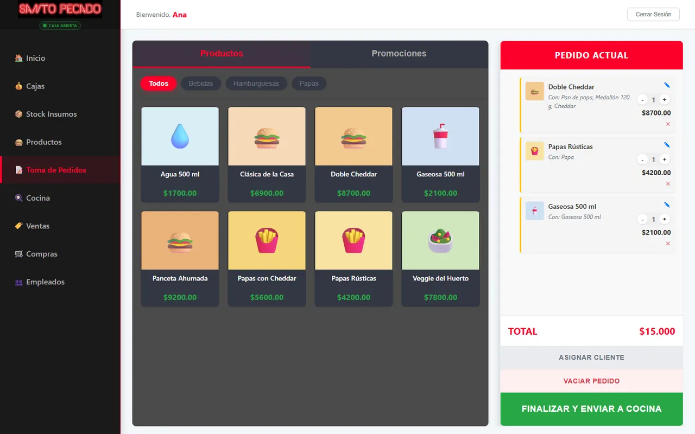
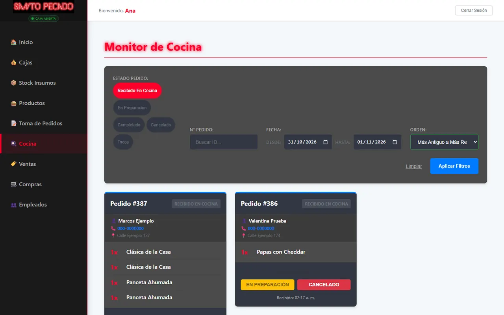

# Santo Pecado · Backend

API REST del sistema de gestión de **Santo Pecado**, una hamburguesería artesanal de Salta: pedidos, monitor de cocina, stock por receta, caja, compras, ventas y personal. **Está en producción**, en uso diario en el local.

> Frontend (React): [santo-pecado-frontend](https://github.com/IvanGG97/santo-pecado-frontend) · Caso de estudio completo: [ivan-gutierrez.netlify.app](https://ivan-gutierrez.netlify.app/es/projects/santo-pecado/)

     

<p>
  
  
</p>

## Decisiones técnicas

### El stock se calcula por receta y se descuenta al empezar a cocinar
Cada producto tiene su receta (`Producto_X_Insumo`). Cuando la cocina pasa un pedido a **En Preparación**, una señal `pre_save` ([`pedido/signals.py`](pedido/signals.py)):

1. Suma los insumos de todos los productos del pedido, **sin contar los ingredientes que el cliente pidió quitar** (por ejemplo, "sin cebolla").
2. Abre una transacción (`transaction.atomic`) y bloquea cada fila de insumo con `select_for_update`, para que dos pedidos simultáneos no lean el mismo stock.
3. Si alcanza, descuenta con `F()` (la resta la hace la base). Si no alcanza, lanza `ValidationError` y **el pedido no avanza**.

Se descuenta al cocinar y no al tomar el pedido porque un pedido puede cancelarse antes de entrar a la cocina.



### Roles por área de trabajo
La autenticación es con **JWT** (SimpleJWT, access + refresh). Los roles son grupos de Django: `Admin`, `Encargado/Cajero`, `Cocina` y `Cliente`. La autenticación es obligatoria por defecto en toda la API, el rol viaja en el token y el frontend protege sus rutas según él. Además, hay permisos propios por vista: por ejemplo, el dashboard de ventas solo lo ven Admin y Encargado/Cajero ([`venta/views.py`](venta/views.py)).

### La caja es el eje del día
Ventas, compras y egresos quedan asociados a una caja que se abre y se cierra, con monto inicial y saldo final.

### Reporte con IA desde el backend
El dashboard pide un resumen y recomendaciones a **Gemini**. La llamada la hace el backend: la API key nunca llega al navegador y un serializer limita qué datos se le envían. Tiene tests con un servidor HTTP local que simula a Gemini ([`venta/test_reporte_ia.py`](venta/test_reporte_ia.py)).

## Modelo de datos (parcial)



## Módulos

| App | Qué resuelve |
|---|---|
| `pedido` | Pedidos, estados y descuento de stock al pasar a En Preparación |
| `inventario` | Productos, insumos, recetas, categorías y alertas de stock mínimo |
| `venta` | Ventas, medios de pago, dashboard y reporte con IA |
| `caja` / `movimiento_caja` | Apertura y cierre de caja, ingresos y egresos |
| `compra` | Compras a proveedores, que suman stock de insumos |
| `promocion` | Combos y promociones |
| `empleado` / `cliente` | Usuarios, roles, registro, activación de cuenta y recuperación de contraseña |

## Correr en local

Requisitos: Python 3.11 o superior y MySQL 8.

```bash
python -m venv venv
source venv/bin/activate          # en Windows: venv\Scripts\activate
pip install -r requirements.txt

cp .env.example .env              # completá SECRET_KEY, credenciales de MySQL y GEMINI_API_KEY
mysql -u root -p -e "CREATE DATABASE santo_db CHARACTER SET utf8mb4;"

python manage.py migrate
python manage.py createsuperuser
python manage.py runserver        # http://localhost:8000
```

Después, desde el admin de Django (`/admin`), creá los grupos `Admin`, `Encargado/Cajero`, `Cocina` y `Cliente`, y los estados de pedido (incluido `En Preparación`, que es el que dispara el descuento de stock).

En desarrollo los mails (activación de cuenta y recuperación de contraseña) se imprimen en la consola.

### Tests

```bash
python manage.py test
```

## Endpoints principales

| Ruta | Descripción |
|---|---|
| `POST /api/token/` · `POST /api/token/refresh/` | Login y refresco del JWT |
| `/api/pedido/` | Pedidos y cambio de estado |
| `/api/inventario/` | Productos, insumos y recetas |
| `/api/venta/` · `POST /api/venta/reporte-ia/` | Ventas y reporte con IA |
| `/api/caja/` · `/api/movimiento-caja/` | Caja y movimientos |
| `/api/compra/` · `/api/promocion/` | Compras y promociones |
| `/api/empleado/` · `/api/cliente/` | Usuarios y roles |

---

Desarrollado por **Iván Gutiérrez** · [Portfolio](https://ivan-gutierrez.netlify.app) · [LinkedIn](https://www.linkedin.com/in/ivan-gutierrez-analista) · [GitHub](https://github.com/IvanGG97)
